<p align="center">
  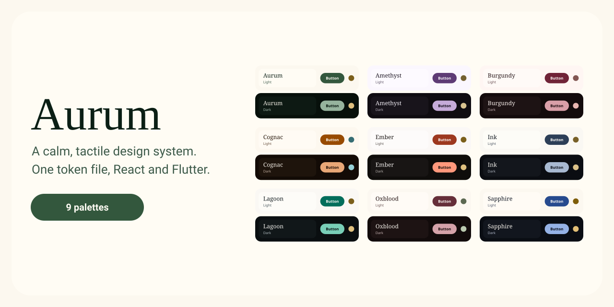
</p>

# Aurum

**A calm, precise, tactile design system: one token file drives a React library and a Flutter library, and each app re-skins it with one brand file.**

[](https://github.com/RenzSamilo/Aurum/actions/workflows/ci.yml)
[](LICENSE)
[](https://github.com/RenzSamilo/Aurum/releases/latest)

## Why Aurum

- **One token file.** Colour, type, spacing, corners, springs, materials and haptics live in `tokens/` and build to CSS, TypeScript and Dart.
- **React and Flutter stay matched.** Every shared component has a contract (one prop list for both platforms), and CI fails when the two drift. See [CONTRACTS.md](catalog/CONTRACTS.md).
- **Contrast is checked at build time.** Every brand is tested against WCAG in light, dark and both high-contrast modes, and the build refuses one that fails, naming the pair and the ratio.

## See it

<p align="center">
  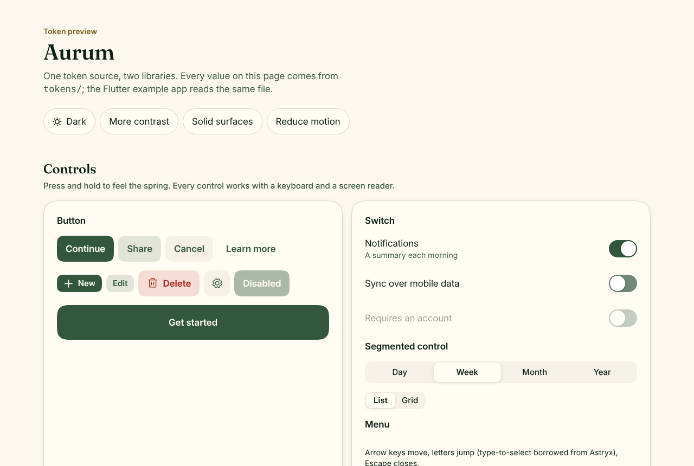
</p>
<p align="center">
  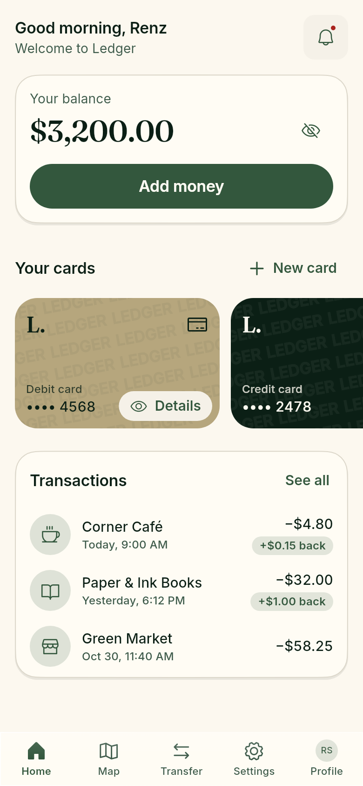
  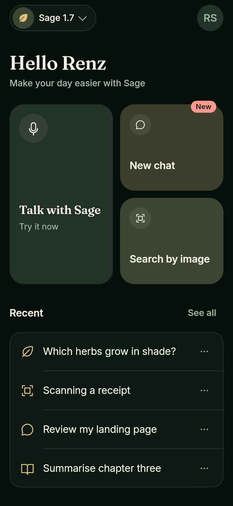
  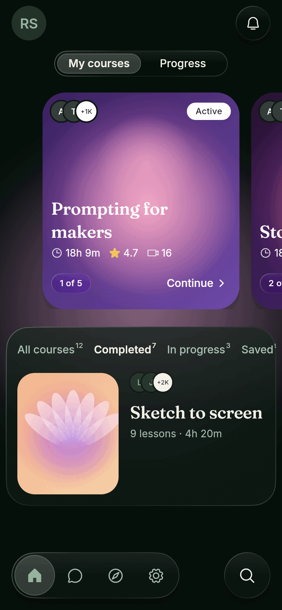
</p>

The web preview (top) is `apps/docs`; the phones are the Flutter example app's sample screens, built only from Aurum parts. More in [docs/assets/screens](docs/assets/screens).

## Quick start (60 seconds)

Pin a release tag, never `main`. The full guide, including brand files and updates, is [docs/USING-AURUM.md](docs/USING-AURUM.md).

**React** (React 19; built JS, types and CSS ship in the package):

```sh
pnpm add "github:RenzSamilo/Aurum#aurum-v0.1.0&path:/packages/react"
```

```tsx
import '@aurum/react/aurum.css';
import { Button, setAurumPreferences } from '@aurum/react';

setAurumPreferences({ theme: 'dark' }); // or leave it to follow the system
export const App = () => <Button>Continue</Button>;
```

**Flutter** (`pubspec.yaml`):

```yaml
dependencies:
  aurum_ui:
    git:
      url: https://github.com/RenzSamilo/Aurum.git
      path: packages/flutter
      ref: aurum-v0.1.0
```

```dart
import 'package:aurum_ui/aurum_ui.dart';

MaterialApp(
  theme: aurumTheme(Brightness.light),
  darkTheme: aurumTheme(Brightness.dark),
  home: Scaffold(body: Center(child: AurumButton(label: 'Continue', onPressed: () {}))),
);
```

## Components

19 components on both platforms, plus haptics and continuous corners. Full list with tags and notes: [catalog/CATALOG.md](catalog/CATALOG.md).

| Component | Web | Flutter |
| --- | :-: | :-: |
| Button, Switch, Segmented control, Text field, Menu | ✓ | ✓ |
| Card, Grouped list (section + row), Sheet, Glass | ✓ | ✓ |
| Top bar, Back button, Tab bar | ✓ | ✓ |
| Avatar, Badge, Progress ring | ✓ | ✓ |
| Floating tab bar | next | ✓ |
| Continuous corners | `<Squircle>` | theme shape |
| Haptics | `playHaptic(intent)` | `AurumHaptics.play(intent)` |

Every component works with a keyboard and a screen reader, honours reduced motion, and is tested (axe-core on the web, Flutter's accessibility guidelines on mobile).

## Palettes

The default look is **Viridian**, an old green: bottle green on parchment, green-black in the dark, gilt gold for ornament, Fraunces serif titles over Inter. Eight more palettes ship as brand files, and each one passes the same contrast checks. Spec cards and contrast receipts: [tokens/brand/PALETTES.md](tokens/brand/PALETTES.md).

| | | |
| :-: | :-: | :-: |
| 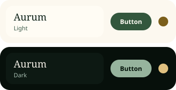<br>**Viridian** (default) | 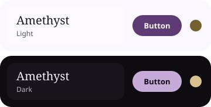<br>**Amethyst** | 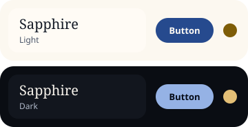<br>**Sapphire** |
| 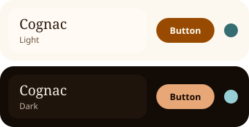<br>**Cognac** | 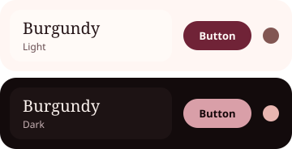<br>**Burgundy** | 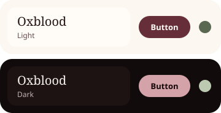<br>**Oxblood** |
| 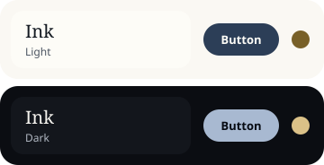<br>**Ink** | 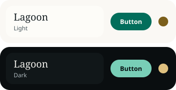<br>**Lagoon** | 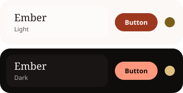<br>**Ember** |

## Make it yours (one file per app)

1. Copy `tokens/brand/aurum.json` (or a palette from `tokens/brand/examples/`) into your app as `my.brand.json`. Change `name`, `accent.hue` (0 to 360) and `accent.chroma`. Optional: `secondary` (the ornament colour), `neutral` tint, `danger`/`warning` hues, `font`, `radius.scale`, and `surfaces.material`: `"translucent"` (glass, the default) or `"opaque"` (every glass surface solid, for apps that should feel flat and calm).
2. Build it: `node path/to/aurum/tools/tokens/build.mjs --brand my.brand.json --css src/aurum-tokens.css --dart lib/my_brand.g.dart`.
3. Web: import your `aurum-tokens.css` after `@aurum/react/aurum.css`. Flutter: `aurumTheme(Brightness.light, brand: myBrand)`.

Text roles, spacing, springs, materials and haptics stay the same across brands, so every app still feels like Aurum. Fonts: `font.ui` sets the UI font and `font.display` the title font; delete `font.display` for an all-sans look. Inter and Fraunces ship with Aurum; any other font must be a variable font with a `wght` axis.

Modes are data attributes on `<html>` (`data-theme`, `data-contrast`, `data-transparency`, `data-motion`); without them, system preferences apply. Safari ignores `prefers-reduced-transparency`, so offer a "Solid surfaces" setting and pass it to `setAurumPreferences`.

## Principles

- **Calm.** Quiet surfaces, one accent, ornament used sparingly.
- **Precise.** Continuous corners, a 4-point spacing scale, optical type sizes.
- **Tactile.** Spring motion, press feedback and haptics that mean something, all off when reduced motion is on.
- **Grows by use.** New pieces start in an app and join Aurum when a second app needs them (the [rule of two](catalog/README.md#the-rule-of-two)).

## Not Apple

Aurum is inspired by the principles of Apple's Human Interface Guidelines. It is not affiliated with Apple and uses only original or openly licensed assets: no SF Pro, SF Symbols, New York, Apple imagery or Apple.com colours. CI enforces this on every change with `pnpm guard`.

Assets and licences:

- Inter Variable 4.1, OFL-1.1 (`packages/flutter/fonts/Inter-OFL.txt`; web via `@fontsource-variable/inter`)
- Fraunces Variable, OFL-1.1 (`packages/flutter/fonts/Fraunces-OFL.txt`; web via `@fontsource-variable/fraunces`)
- Phosphor icons, MIT (`@phosphor-icons/react`, `phosphor_glyphs` on Flutter)

## Roadmap

- **Phase 0** (done): monorepo, token pipeline, CI, previews.
- **Phase 1** (done): brand layer; Button, Switch, Segmented control, List row + card, Sheet on both platforms; haptics; glass; squircle polyfill for Safari and Firefox.
- **Phase 2**: v1 components and generic flows (settings, list and detail, form, onboarding).
- **Phase 3**: pickers, charts, polish.

## More

- [docs/USING-AURUM.md](docs/USING-AURUM.md): install Aurum in an app, add a brand, update.
- [docs/DEVELOPING.md](docs/DEVELOPING.md): repo layout, commands, releasing.
- [catalog/README.md](catalog/README.md): shelves, kits, contracts, how Aurum grows.
- [CONTRIBUTING.md](CONTRIBUTING.md) · [SECURITY.md](SECURITY.md) · [CHANGELOG.md](CHANGELOG.md)

MIT © 2026 Renz Samilo. See [LICENSE](LICENSE).
