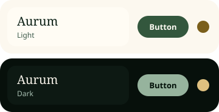
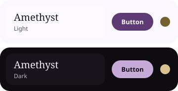
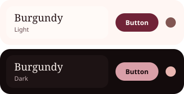
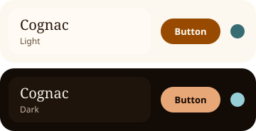
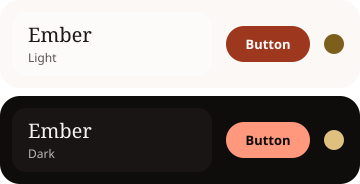
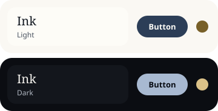
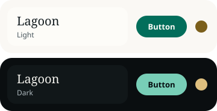
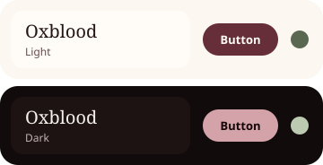
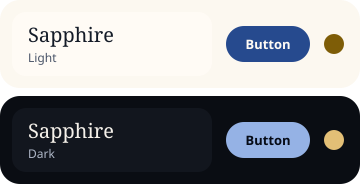

<!-- Generated by tools/tokens/palettes.mjs from the brand files. Do not edit by hand: run `pnpm palettes`. -->

# Aurum palettes

Every palette is one brand file. Pick one for an app, or copy one as a starting point. Each card shows what it's for and proves it's readable: the build refuses any palette that fails a contrast rule, and the receipt lists its weakest pair per rule, in all four modes.

## Aurum (default)

The Viridian look. Old green: bottle green on parchment with gilt gold ornament, like an antique book or a brass clock face. Calm and trustworthy.

- **Best for:** Default for new apps, Fitness and habit apps (TREN), Productivity, Reading and learning
- **Avoid for:** Loud, playful consumer apps.
- **Light:** accent `#33573D` · accent-secondary `#7B5F1B` · surface-canvas `#FCF8EF` · text-primary `#0B1F15`
- **Dark:** accent `#96B39D` · accent-secondary `#DFC07F` · surface-canvas `#07100B` · text-primary `#F5F1E8`
- **File:** [`aurum.json`](aurum.json)

Contrast receipt: the weakest pair for each rule (WCAG 2.2 AA).

| Mode | body text (≥ 4.5) | accent and status text (≥ 4.5) | control borders (1.4.11) (≥ 3) | text on filled buttons (≥ 4.5) |
| --- | :-: | :-: | :-: | :-: |
| Light | ✓ 5.25 | ✓ 5.38 | ✓ 3.46 | ✓ 7.99 |
| Dark | ✓ 5.48 | ✓ 6.38 | ✓ 3.72 | ✓ 8.65 |
| Light, more contrast | ✓ 8.06 | ✓ 5.38 | ✓ 5.25 | ✓ 7.99 |
| Dark, more contrast | ✓ 7.83 | ✓ 6.38 | ✓ 5.91 | ✓ 8.65 |

## Amethyst

Deep violet on lilac-tinted paper with a soft gold accent. Thoughtful and a little luxurious.

- **Best for:** Learning and courses, Journaling and wellbeing, AI assistant apps
- **Avoid for:** Finance dashboards, where violet can read as unserious.
- **Light:** accent `#5E3B75` · accent-secondary `#746131` · surface-canvas `#FBF7FE` · text-primary `#1E1723`
- **Dark:** accent `#C6ABD9` · accent-secondary `#D8C290` · surface-canvas `#0F0C11` · text-primary `#F4F0F7`
- **File:** [`examples/amethyst.json`](examples/amethyst.json)

Contrast receipt: the weakest pair for each rule (WCAG 2.2 AA).

| Mode | body text (≥ 4.5) | accent and status text (≥ 4.5) | control borders (1.4.11) (≥ 3) | text on filled buttons (≥ 4.5) |
| --- | :-: | :-: | :-: | :-: |
| Light | ✓ 5.38 | ✓ 5.34 | ✓ 3.54 | ✓ 8.6 |
| Dark | ✓ 5.45 | ✓ 6.99 | ✓ 3.68 | ✓ 9.62 |
| Light, more contrast | ✓ 8.26 | ✓ 5.34 | ✓ 5.38 | ✓ 8.6 |
| Dark, more contrast | ✓ 7.8 | ✓ 6.99 | ✓ 5.87 | ✓ 9.62 |

## Burgundy

Wine red on warm cream with a rosy secondary. Elegant and bold.

- **Best for:** Commerce and luxury, Events and booking, Media
- **Avoid for:** Finance: red reads as loss next to numbers.
- **Light:** accent `#702337` · accent-secondary `#825652` · surface-canvas `#FFF6F3` · text-primary `#261518`
- **Dark:** accent `#D99FA8` · accent-secondary `#E9B6B1` · surface-canvas `#130B0C` · text-primary `#F9F0EC`
- **File:** [`examples/burgundy.json`](examples/burgundy.json)

Contrast receipt: the weakest pair for each rule (WCAG 2.2 AA).

| Mode | body text (≥ 4.5) | accent and status text (≥ 4.5) | control borders (1.4.11) (≥ 3) | text on filled buttons (≥ 4.5) |
| --- | :-: | :-: | :-: | :-: |
| Light | ✓ 5.4 | ✓ 5.42 | ✓ 3.55 | ✓ 10.24 |
| Dark | ✓ 5.45 | ✓ 6.65 | ✓ 3.68 | ✓ 8.92 |
| Light, more contrast | ✓ 8.29 | ✓ 5.42 | ✓ 5.4 | ✓ 10.24 |
| Dark, more contrast | ✓ 7.8 | ✓ 6.65 | ✓ 5.86 | ✓ 8.92 |

## Cognac

Warm amber-brown leather with a steel-blue secondary. Rich, crafted, inviting.

- **Best for:** Food and nutrition, Commerce and shopping, Travel
- **Avoid for:** Dense data screens: the warm accent tires the eye at scale.
- **Light:** accent `#984B00` · accent-secondary `#356D73` · surface-canvas `#FDF8EF` · text-primary `#26170A`
- **Dark:** accent `#E8A777` · accent-secondary `#96D0D6` · surface-canvas `#130B06` · text-primary `#F6F1E8`
- **File:** [`examples/cognac.json`](examples/cognac.json)

Contrast receipt: the weakest pair for each rule (WCAG 2.2 AA).

| Mode | body text (≥ 4.5) | accent and status text (≥ 4.5) | control borders (1.4.11) (≥ 3) | text on filled buttons (≥ 4.5) |
| --- | :-: | :-: | :-: | :-: |
| Light | ✓ 5.38 | ✓ 5.19 | ✓ 3.54 | ✓ 6.07 |
| Dark | ✓ 5.45 | ✓ 6.98 | ✓ 3.69 | ✓ 9.62 |
| Light, more contrast | ✓ 8.27 | ✓ 5.19 | ✓ 5.38 | ✓ 6.07 |
| Dark, more contrast | ✓ 7.8 | ✓ 6.98 | ✓ 5.87 | ✓ 9.62 |

## Ember

Warm orange on lightly tinted neutrals. Energetic and friendly.

- **Best for:** Fitness and sport, Food, Social
- **Avoid for:** Calm or serious tools (finance, health records).
- **Light:** accent `#9D381F` · accent-secondary `#7B5F1B` · surface-canvas `#FBF8F6` · text-primary `#1E1917`
- **Dark:** accent `#FF987C` · accent-secondary `#DFC07F` · surface-canvas `#0F0D0B` · text-primary `#F4F1EF`
- **File:** [`examples/ember.json`](examples/ember.json)

Contrast receipt: the weakest pair for each rule (WCAG 2.2 AA).

| Mode | body text (≥ 4.5) | accent and status text (≥ 4.5) | control borders (1.4.11) (≥ 3) | text on filled buttons (≥ 4.5) |
| --- | :-: | :-: | :-: | :-: |
| Light | ✓ 5.35 | ✓ 5.37 | ✓ 3.52 | ✓ 6.79 |
| Dark | ✓ 5.46 | ✓ 6.96 | ✓ 3.69 | ✓ 9.38 |
| Light, more contrast | ✓ 8.22 | ✓ 5.37 | ✓ 5.35 | ✓ 6.79 |
| Dark, more contrast | ✓ 7.81 | ✓ 6.96 | ✓ 5.88 | ✓ 9.38 |

## Ink

Near-black indigo on paper with a gold secondary. Editorial and restrained.

- **Best for:** Writing and notes, Productivity, Portfolios and marketing sites
- **Avoid for:** Playful or kids apps.
- **Light:** accent `#2C3E57` · accent-secondary `#786028` · surface-canvas `#FAF8F3` · text-primary `#151B23`
- **Dark:** accent `#A8B9D1` · accent-secondary `#DBC188` · surface-canvas `#0B0D12` · text-primary `#F4F2ED`
- **File:** [`examples/ink.json`](examples/ink.json)

Contrast receipt: the weakest pair for each rule (WCAG 2.2 AA).

| Mode | body text (≥ 4.5) | accent and status text (≥ 4.5) | control borders (1.4.11) (≥ 3) | text on filled buttons (≥ 4.5) |
| --- | :-: | :-: | :-: | :-: |
| Light | ✓ 5.34 | ✓ 5.37 | ✓ 3.51 | ✓ 10.56 |
| Dark | ✓ 5.46 | ✓ 6.94 | ✓ 3.7 | ✓ 9.84 |
| Light, more contrast | ✓ 8.19 | ✓ 5.37 | ✓ 5.34 | ✓ 10.56 |
| Dark, more contrast | ✓ 7.81 | ✓ 6.94 | ✓ 5.88 | ✓ 9.84 |

## Lagoon

The original teal on cool grey. Fresh and modern.

- **Best for:** Health and wellness, Travel, Utilities
- **Avoid for:** Apps that should feel heritage or premium.
- **Light:** accent `#026E5B` · accent-secondary `#7B5F1B` · surface-canvas `#FAF8F4` · text-primary `#131C20`
- **Dark:** accent `#78CEB7` · accent-secondary `#DFC07F` · surface-canvas `#0A0E10` · text-primary `#F3F2ED`
- **File:** [`examples/lagoon.json`](examples/lagoon.json)

Contrast receipt: the weakest pair for each rule (WCAG 2.2 AA).

| Mode | body text (≥ 4.5) | accent and status text (≥ 4.5) | control borders (1.4.11) (≥ 3) | text on filled buttons (≥ 4.5) |
| --- | :-: | :-: | :-: | :-: |
| Light | ✓ 5.32 | ✓ 5.38 | ✓ 3.5 | ✓ 6.05 |
| Dark | ✓ 5.47 | ✓ 6.93 | ✓ 3.7 | ✓ 10.56 |
| Light, more contrast | ✓ 8.16 | ✓ 5.38 | ✓ 5.32 | ✓ 6.05 |
| Dark, more contrast | ✓ 7.82 | ✓ 6.93 | ✓ 5.89 | ✓ 10.56 |

## Oxblood

A quieter, browner red with a sage secondary. Heritage and leather-bound.

- **Best for:** Reading and media, Commerce, Personal brand sites
- **Avoid for:** Error-heavy flows, where the accent competes with danger red.
- **Light:** accent `#652E39` · accent-secondary `#5B6851` · surface-canvas `#FCF8F1` · text-primary `#251616`
- **Dark:** accent `#D4A2A9` · accent-secondary `#BBCAB0` · surface-canvas `#120B0B` · text-primary `#F5F1EA`
- **File:** [`examples/oxblood.json`](examples/oxblood.json)

Contrast receipt: the weakest pair for each rule (WCAG 2.2 AA).

| Mode | body text (≥ 4.5) | accent and status text (≥ 4.5) | control borders (1.4.11) (≥ 3) | text on filled buttons (≥ 4.5) |
| --- | :-: | :-: | :-: | :-: |
| Light | ✓ 5.4 | ✓ 5.26 | ✓ 3.55 | ✓ 10.14 |
| Dark | ✓ 5.45 | ✓ 6.67 | ✓ 3.68 | ✓ 8.95 |
| Light, more contrast | ✓ 8.29 | ✓ 5.26 | ✓ 5.4 | ✓ 10.14 |
| Dark, more contrast | ✓ 7.8 | ✓ 6.67 | ✓ 5.86 | ✓ 8.95 |

## Sapphire

Ink-blue on cool paper with bright gold ornament. Clear, confident, professional.

- **Best for:** Finance and banking, Productivity and work tools, Marketing sites
- **Avoid for:** Food and wellness, where blue can feel cold.
- **Light:** accent `#264A8E` · accent-secondary `#7E5D07` · surface-canvas `#FCF8F0` · text-primary `#141B27`
- **Dark:** accent `#95B2E5` · accent-secondary `#E3BF76` · surface-canvas `#0A0D13` · text-primary `#F5F1EA`
- **File:** [`examples/sapphire.json`](examples/sapphire.json)

Contrast receipt: the weakest pair for each rule (WCAG 2.2 AA).

| Mode | body text (≥ 4.5) | accent and status text (≥ 4.5) | control borders (1.4.11) (≥ 3) | text on filled buttons (≥ 4.5) |
| --- | :-: | :-: | :-: | :-: |
| Light | ✓ 5.34 | ✓ 5.39 | ✓ 3.51 | ✓ 8.36 |
| Dark | ✓ 5.46 | ✓ 6.78 | ✓ 3.7 | ✓ 9.15 |
| Light, more contrast | ✓ 8.2 | ✓ 5.39 | ✓ 5.34 | ✓ 8.36 |
| Dark, more contrast | ✓ 7.81 | ✓ 6.78 | ✓ 5.88 | ✓ 9.15 |
